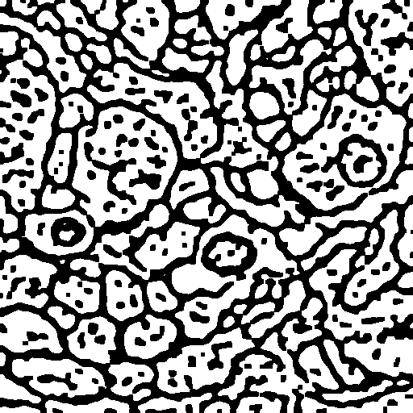
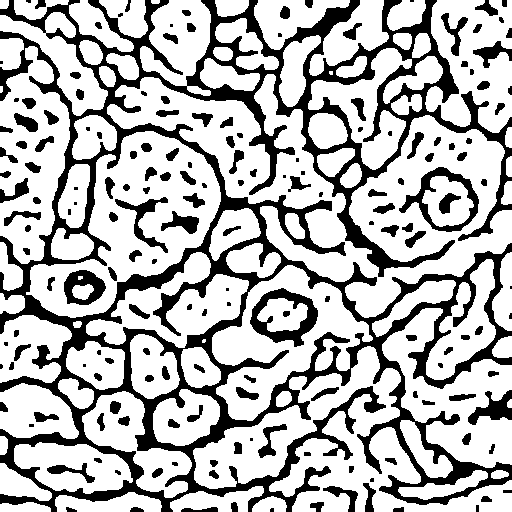

# Лабораторная работа №1. Дилатация (вариант 6) 
# Тукаев Роберт

## Цель работы
Научиться реализовывать один из простых алгоритмов обработки изображений — 
морфологическую операцию **дилатации** с примитивом (структурным элементом) 
размера 3×3. Алгоритм реализован в двух вариантах: с помощью библиотеки OpenCV 
и нативно на Python.

## 1. Теоретическая база

**Математическая морфология** — набор методов обработки изображений, 
основанных на теории множеств. Применяется к бинарным (и полутоновым) 
изображениям.

**Дилатация (наращивание)** — одна из базовых морфологических операций. 
Она «расширяет» светлые области изображения.

Формально дилатация множества A структурным элементом B:

```
A ⊕ B = { z | (B̂)_z ∩ A ≠ ∅ }
```

На практике: структурный элемент (примитив) 3×3 «накладывается» на каждый 
пиксель изображения. Если хотя бы один пиксель под примитивом белый (255), 
то центральный пиксель результата становится белым.

**Эффект:** объекты на изображении увеличиваются в размерах, мелкие разрывы 
и отверстия заполняются, тонкие соединяются.

Перед дилатацией изображение бинаризуется (пороговая обработка): пиксели 
делятся на фон (0) и объект (255).

## 2. Описание разработанной системы

Программа написана на Python и состоит из следующих функций:

- `to_binary()` — загрузка изображения в оттенках серого и бинаризация 
  пороговым методом (`cv2.threshold`). Ручная бинаризация по заданию не требуется.
- `dilation_opencv()` — дилатация встроенной функцией `cv2.dilate()` с 
  ядром 3×3 из единиц.
- `dilation_native()` — собственная реализация:
  1. Изображение дополняется рамкой из нулей (padding) для обработки краёв.
  2. Для каждого пикселя рассматривается окно 3×3.
  3. Если максимум в окне равен 255 — результирующий пиксель = 255.
- `main()` — запускает оба варианта, замеряет время (`time.perf_counter`), 
  сохраняет результаты и сравнивает их на идентичность.

### Принцип работы примитива 3×3
```
1 1 1
1 1 1
1 1 1
```
Все элементы единичные — учитываются все 8 соседей и сам центральный пиксель.

## 3. Результаты работы и тестирования

### Исходное и бинаризованное изображение
| Бинарное | Дилатация |
|----------|-----------|
|  |  |

### Сравнение быстродействия

| Реализация | Время, с |
|------------|----------|
| OpenCV     | 0.000474   |
| Native     | 1.414501   |

Результаты обеих реализаций **идентичны** (`np.array_equal == True`), 
что подтверждает корректность нативного алгоритма.

**Закономерность:** OpenCV работает в сотни–тысячи раз быстрее за счёт 
оптимизированных C++ реализаций и векторизации, тогда как нативный вариант 
использует вложенные циклы Python, что медленно.

## 4. Выводы

В ходе работы изучена и реализована морфологическая операция дилатации 
с примитивом 3×3 в двух вариантах. Оба варианта дают идентичный результат, 
что подтверждает корректность собственной реализации. 

Сравнение быстродействия показало значительное преимущество библиотеки 
OpenCV над нативной реализацией на чистом Python из-за оптимизаций на 
низком уровне. На практике для реальных задач предпочтительно использовать 
библиотечные функции.

## 5. Использованные источники
1. Гонсалес Р., Вудс Р. «Цифровая обработка изображений».
2. Документация OpenCV: https://docs.opencv.org/
3. Документация NumPy: https://numpy.org/doc/
